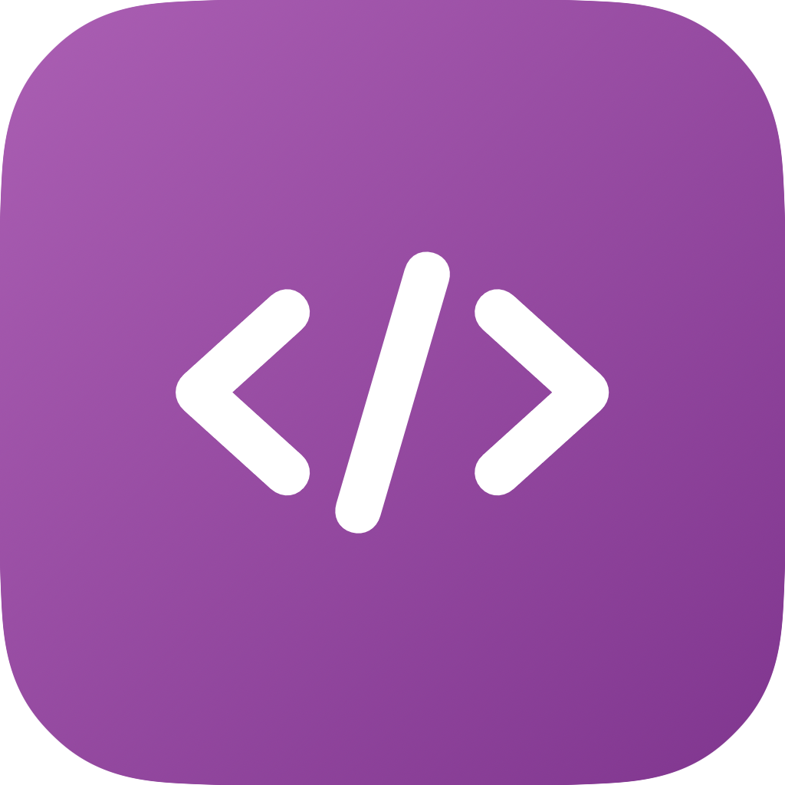
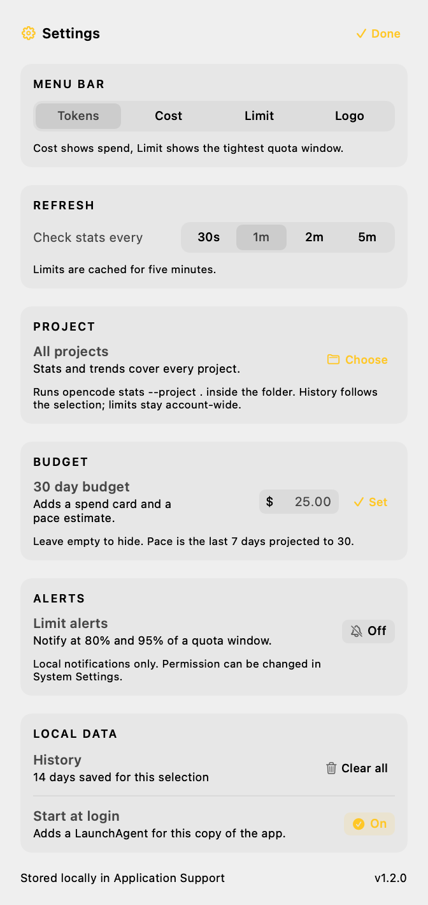

<p align="center">
  
</p>

<h1 align="center">OpenCode Meter</h1>

<p align="center">Your <a href="https://opencode.ai">OpenCode</a> usage, quotas and token totals in the menu bar.</p>

It reads `opencode stats --json` and the local usage limits endpoint. No account, no API key, no telemetry, no network calls beyond your own OpenCode server. Everything stays on your Mac, including the daily history used for trends.

<p align="center">
  
  
</p>

## Features

- **Limits on top**: 5 hour, weekly and monthly quota usage with reset countdown
- **Limit alerts**: optional local notification at 80% and 95% of a quota window
- **Project filter**: scope stats, trends and history to one project folder
- **Budget**: optional 30 day budget, spend progress and a pace estimate
- **Menu bar**: tokens, cost, the tightest quota, or just the app mark
- **Dashboard**: cost, token split (input, output, reasoning, cache)
- **Models**: top three models by token share
- **Activity**: daily steps or token history, with a 7 day comparison
- **History**: daily totals saved locally per project scope, so trends survive restarts
- **Counters**: sessions, steps, prompts, tool calls
- **Periods**: Today, 7 days, 30 days, all time
- **Settings**: refresh cadence, menu bar mode, project, budget, alerts, login item, history
- **Welcome screen**: first run check for the CLI and local data
- Light and dark mode, system accent color, no Dock icon

## Requirements

- macOS 14 or later
- [OpenCode](https://opencode.ai) installed and used at least once
- Xcode Command Line Tools (`xcode-select --install`)

## Install

```sh
git clone https://github.com/MrShiroLu/opencodeUsage.git
cd opencodeUsage
./run.sh
```

`run.sh` builds the app, asks where to install it (default `~/Applications`), offers a start at login item, then launches it. A fresh install opens the welcome screen. Use `--fresh` to reset onboarding, `--yes` to accept every default.

Build settings live in `.env` (copy from `.env.example`).

## Usage

Click the menu bar item to open the dashboard.

| Control | What it does |
| --- | --- |
| Help | Opens the welcome screen |
| Tokens / Cost / Limit / Logo | Cycles what the menu bar shows |
| Refresh | Reloads stats and limits now |
| Quit | Closes the app |
| Settings (gear) | Refresh cadence, menu bar mode, project, budget, alerts, login item, history |

<p align="center">
  
</p>

Limits and stats refresh every 60 seconds by default. Pick 30 seconds to 5 minutes in Settings. They also refresh whenever the popover opens; limits are cached for five minutes.

The menu bar can show the token total, the spend, the tightest quota percentage (orange above 80%, red at the limit), or just the mark.

## Budget

Set a 30 day budget in Settings. The dashboard then adds a budget row with the last 30 days of spend and a pace estimate: the last seven days projected to 30 days. Clear the field to hide the row.

## Project filter

**Choose** in the Project card scopes the dashboard to one folder. The app runs `opencode stats --project .` with that folder as the working directory, so session counts, tokens, models and the chart cover only that project. **All** goes back to every project.

History is stored per selection, so a project keeps its own trend line. Limits come from your account, so they stay the same whichever project is selected.

## Limit alerts

Turn on **Limit alerts** in Settings to get a local notification when a quota window reaches 80%, and again at 95% or when it is limited. Each window alerts once per threshold per reset, so a long refresh cadence does not repeat the same banner.

macOS asks for notification permission the first time you enable it, and the toggle stays off if you decline. Change it later in System Settings > Notifications. Alerts are delivered by the app itself; nothing is sent anywhere.

## History

Every refresh records today's totals in `~/Library/Application Support/OpenCodeMeter/history.json`, grouped by project scope (`all` or `project:<path>`). The chart can switch between daily steps and stored daily tokens, and the token view compares the last seven days with the seven before once enough history exists. History is capped at 180 days per scope and can be cleared from Settings. Nothing leaves the Mac.


## Start at login

Toggle **Start at login** in Settings. It writes `~/Library/LaunchAgents/dev.local.opencode-meter.plist` for the copy of the app you are running. Turn it off to remove the file.

The same thing from a terminal:

```sh
./Support/install-login-item.sh
```

## How it works

The app runs the OpenCode CLI and parses its JSON:

```
opencode stats --days N --cost --json
opencode stats --days N --cost --json --project .
opencode api get /api/experimental/usage/limits
```

The `--project .` call is used only when a project folder is selected, and runs inside that folder.

Each refresh reads the selected period, today, and the last week, plus the last 30 days when a budget is set. That keeps the chart and budget filled even when you browse Today. Switching periods or projects reuses a cached snapshot while the new one loads, so the popover keeps its size. The result is rendered with SwiftUI inside an `NSPopover`. There is no database access and no background daemon. The only moving parts are the OpenCode CLI and its local server.

`opencode` is looked up in `/opt/homebrew/bin`, `/usr/local/bin`, `~/.bun/bin` and `~/.local/bin`, then through a login shell (`command -v opencode`).

## Development

```sh
make build          # compile and ad-hoc sign into build/OpenCodeMeter.app
make run            # build and launch
make print          # one stats snapshot, no UI
make render         # regenerate docs/*.png from the live design
make icon           # regenerate docs/icon.png
make uninstall      # remove ~/Applications/OpenCodeMeter.app
```

Design check without screen recording permissions:

```sh
OCMETER_RENDER=/tmp/meter.png build/OpenCodeMeter.app/Contents/MacOS/OpenCodeMeter
OCMETER_DEMO=1 OCMETER_RENDER=/tmp/meter-demo.png build/OpenCodeMeter.app/Contents/MacOS/OpenCodeMeter
OCMETER_WELCOME=1 OCMETER_RENDER=/tmp/welcome.png build/OpenCodeMeter.app/Contents/MacOS/OpenCodeMeter
OCMETER_DEMO=1 OCMETER_SETTINGS=1 OCMETER_RENDER=/tmp/settings.png build/OpenCodeMeter.app/Contents/MacOS/OpenCodeMeter
OCMETER_PROJECT="$HOME/Projects/myapp" OCMETER_PRINT=1 build/OpenCodeMeter.app/Contents/MacOS/OpenCodeMeter
```

## License

MIT. See [LICENSE](LICENSE).
