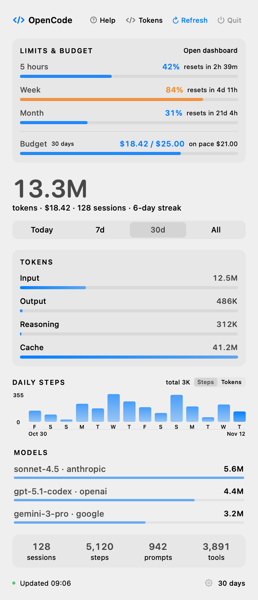
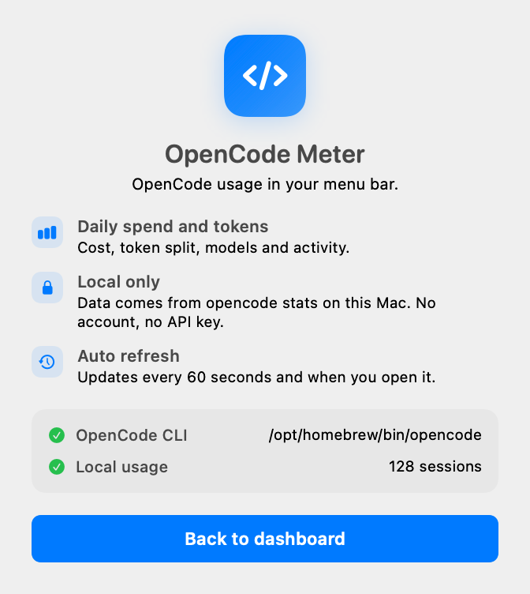

# OpenCode Meter

A small menu bar app for macOS that shows your [OpenCode](https://opencode.ai) usage.

It reads `opencode stats --json` and the local usage limits endpoint. No account, no API key, no telemetry, no network calls beyond your own OpenCode server. Everything stays on your Mac.

<p align="center">
  
  
</p>

## Features

- **Limits on top**: 5 hour, weekly and monthly quota usage with reset countdown
- **Menu bar**: token count, or a single emoji if you prefer a quiet icon
- **Dashboard**: cost, token split (input, output, reasoning, cache)
- **Models**: top three models by token share
- **Activity**: 14 day chart with value and date axes
- **Counters**: sessions, steps, prompts, tool calls
- **Periods**: Today, 7 days, 30 days, all time
- **Welcome screen**: first run check for the CLI and local data
- Light and dark mode, system accent color, no Dock icon

## Requirements

- macOS 14 or later
- [OpenCode](https://opencode.ai) installed and used at least once
- Xcode Command Line Tools (`xcode-select --install`)

## Install

```sh
git clone https://github.com/MrShiroLu/opencodeUsage.git
cd opencodeUsage
./run.sh
```

`run.sh` builds the app, asks where to install it (default `~/Applications`), offers a start at login item, then launches it. A fresh install opens the welcome screen. Use `--fresh` to reset onboarding, `--yes` to accept every default.

Build settings live in `.env` (copy from `.env.example`).

## Usage

Click the menu bar item to open the dashboard.

| Control | What it does |
| --- | --- |
| Help | Opens the welcome screen |
| Tokens / Emoji | Switches what the menu bar shows |
| Refresh | Reloads stats and limits now |
| Quit | Closes the app |

Limits and stats refresh every 60 seconds, and whenever the popover opens.

## Start at login

```sh
./Support/install-login-item.sh
```

It writes `~/Library/LaunchAgents/dev.local.opencode-meter.plist`. Remove that file to stop it.

## How it works

The app runs two commands and parses their JSON:

```
opencode stats --days N --cost --json
opencode api get /api/experimental/usage/limits
```

The result is rendered with SwiftUI inside an `NSPopover`. There is no database access and no background daemon. The only moving parts are the OpenCode CLI and its local server.

`opencode` is looked up in `/opt/homebrew/bin`, `/usr/local/bin`, `~/.bun/bin` and `~/.local/bin`, then through a login shell (`command -v opencode`).

## Development

```sh
make build          # compile and ad-hoc sign into build/OpenCodeMeter.app
make run            # build and launch
make print          # one stats snapshot, no UI
make render         # regenerate docs/*.png from the live design
make uninstall      # remove ~/Applications/OpenCodeMeter.app
```

Design check without screen recording permissions:

```sh
OCMETER_RENDER=/tmp/meter.png build/OpenCodeMeter.app/Contents/MacOS/OpenCodeMeter
OCMETER_DEMO=1 OCMETER_RENDER=/tmp/meter-demo.png build/OpenCodeMeter.app/Contents/MacOS/OpenCodeMeter
OCMETER_WELCOME=1 OCMETER_RENDER=/tmp/welcome.png build/OpenCodeMeter.app/Contents/MacOS/OpenCodeMeter
```

## License

MIT. See [LICENSE](LICENSE).
